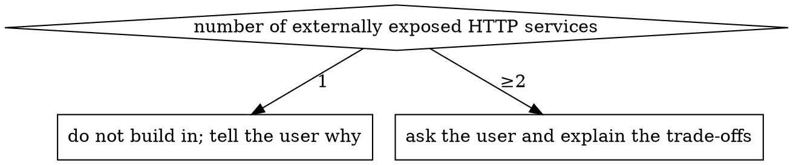

# VibeSOP: init-deployment

## Overview

Captures a way of running local dev / intranet / gray / production Docker environments, proven on real projects, as an initialization flow that can be copied into any website project. It is independent of language, framework and number of services. Everything is abstracted as a **service inventory**: each service = name + build method + port + data directory + stateful or not.

**Core principle: every value in an environment is the user's decision. Detect first, then ask, then have the user confirm the decision table, and only then generate files. State every default you adopt and every module you skip.**

## Language

This file is in English so that anyone can review it. That says nothing about the language to use with the user.

- **Talking to the user:** use the language of the user's own messages, from the first reply on. This covers questions, tables and the final report. Commands, paths, file names and code stay as they are.
- **Files written into the repository:** use the project's document language. Read it from the governance record when there is one (see step 1); otherwise use the conversation language.
- **Chinese wording:** `references/glossary.md` fixes the Chinese term for each concept in this file. Use those terms so one thing keeps one name.
- A language set explicitly by the user or by the project's instruction files takes precedence over all of the above.

## When to use

- A new project needs a Docker environment and management scripts from scratch
- An existing project needs one more environment (commonly: gray, or an intranet test machine)
- Deployment files are scattered, and the user wants one directory layout, one script entry point and one image naming scheme

Not applicable: Kubernetes, serverless and pure static hosting (Vercel, OSS static sites). When the project is one of these, tell the user directly that this skill does not cover it.

A project that already has a deployment structure: **fill gaps, do not tear down**. List the current state and the differences first, and let the user choose which to change.

Document layout and AI instruction files belong to `vibesop-init-project`.

## Flow

### 1. Detect (read-only)

Read the project and change nothing. Establish:

- **Service inventory**: the processes that can run on their own (backend, frontend, admin console, small tools, …), each with its tech stack, start command and listening port
- **Stateful dependencies**: databases, caches, message queues, object storage
- **Background jobs**: scheduled tasks, queue consumers, workers (the key risk in the gray environment)
- **Build-time variables**: variables baked into the build output (`NEXT_PUBLIC_*`, `VITE_*`, `REACT_APP_*` and the like)
- **Existing deployment files**: Dockerfile, compose, scripts, `.env*`, CI config
- **Database migration tool**: whether there is one and how it runs
- **Governance record**: the table at the top of `docs/_internal/README.md` or `docs/README.md`, written by `vibesop-init-project`. It may be written in Chinese; `references/glossary.md` lists the Chinese field names. Read the visibility and the document language from it when it exists.

### 2. Report and confirm the service inventory

Tell the user the findings in one table and ask for corrections. If the service inventory is wrong, everything after it is wrong.

### 3. Ask in batches

**Required:** ask in the batches of `references/questionnaire.md`. Use the client's question tool when it has one, otherwise a numbered list. Ask at most 4 questions per batch, each with a recommended default and a one-line reason. Finish one batch before asking the next. The answers to a batch decide whether later batches appear.

Do not treat detected values as confirmed values. Detection results are **recommended defaults**, and they are still asked.

### 4. Confirm the decision table

Collect all answers into a decision table: environment / service / image name / port / data directory / config location / image registry / optional modules, plus **every skipped module and the reason**. Wait for the user to confirm before touching anything.

### 5. Generate

Generate from `templates/`. The placeholder reference is at the end of `references/questionnaire.md`. The structure and rules of each environment are in `references/environments.md`. Optional modules are in `references/optional-modules.md`.

- The open-source route uses `install.sh.template`, `docker-compose.release.yml.template` and the two `github-actions-dockerhub*.yml.template` files. Generation and verification requirements are in `references/open-source-route.md`
- In a template, the text between `# >>> NAME` and `# <<< NAME` is an optional block. When the user did not choose the matching feature, delete the whole block, marker lines included
- There is no template for the Dockerfile. Write it for the detected tech stack, following "Dockerfile conventions" in `references/environments.md`
- Write the confirmed decision table into `<deploy directory>/README.md` for later sessions to read
- The script and compose templates carry Chinese comments and Chinese user-facing strings (echo output, prompts, help text) in this release. When the document language is not Chinese, translate those comments and strings while filling each template in. Commands, variable names and block marker names stay unchanged. Step 6 then checks every script with `bash -n`.

### 6. Verify

Run each item and cite the output as evidence:

```bash
bash -n <each generated script>
docker compose -f <each compose file> config -q      # needs a .env first; with none, copy .env.example to a temporary one and delete it after verifying.
                                                     # for a compose file that references env_file or secret files, run the matching script's init first
git check-ignore -v <data directories inside the repo> <secret files> <.env>   # every item must match an ignore rule; paths outside the repo do not apply, so confirm instead that they are not under the repository directory
git add -n <each *.example file>                     # every item must be listed: example files are committed, and the ignore rules must not catch them by mistake
command grep -rnE '\{\{[A-Z_]+\}\}' <deploy directory> <script directory>   # no placeholder may remain; `command` bypasses shell aliases that skip ignored files
```

Go through the list in `references/pitfalls.md`.

### 7. Deliver

Give the user: the list of generated files, a quick reference of commands for each environment, and **what the user must do personally** (fill in `.env`, configure the ACR credentials, `chown` the data directories on the server, configure the reverse proxy and the domain).

## Release route

The first question asked (question 0.1). It decides the direction of the whole flow:

| Route | Default | Deliverables | Rules |
|---|---|---|---|
| Private project | ✅ | Management scripts in the repository (`dev.sh` / `prod.sh`) + a compose file per environment; images go to a private image registry | the rest of this file |
| Open-source project | optional | Public images on Docker Hub + tag-triggered CI release + a single-file script that users install with one command | `references/open-source-route.md` |

When the governance record says the visibility is open source, recommend the open-source route as the default for question 0.1. In every other case the private route stays the default. The question is still asked.

On the open-source route, the sections "Environment selection", "Deploy account" and "Alibaba Cloud image registry" below do not apply (the end user picks the run identity in the install wizard). The local dev environment is still generated.

## Environment selection

| Environment | Default | Role |
|---|---|---|
| Local dev | ✅ | Source mounted + hot reload; data lands in a local ignored directory |
| Production | ✅ | Runs images; the application and database lifecycles are separate |
| Intranet | optional | LAN test or staging machine with its own data; same structure as production |
| Gray | optional | Runs beside production on the same machine; traffic splitting validates the new version |

When gray is chosen, you must follow up with "shared production database or separate database", and apply the gray rules in the "Gray" section of `references/environments.md`.

## Deploy account

The server user may be root, a sudo user, or a regular user in the docker group. Support all three. Ask which one, and decide it separately from the user the container runs as. The combination of the two decides whether the data directories need `chown` and whether command examples carry `sudo`. The rules are in "Deploy account and file ownership" in `references/environments.md`.

## Reverse proxy container: when to ask



The trade-offs are in "Reverse proxy" in `references/optional-modules.md`. On both branches, let the user know the conclusion and the reason.

## Alibaba Cloud image registry

Ask whether images are pushed to Alibaba Cloud ACR. If yes, ask "has ACR already been set up". If it has not, or the user is unsure, guide step by step with `references/aliyun-acr.md`, then continue. If no, let the user choose between "clone the repository on the server and build there" and "carry images by hand with `docker save/load`". Explain that the former requires the server to reach the code repository and the dependency sources.

## Red lines

- Do not decide silently for the user: a value that was never asked is not written to disk
- Passwords, keys and tokens go only into ignored files. Only `*.example` templates are committed to git
- Do not run `docker push` automatically, do not log in to a server, do not change anything live, do not run git commit or push. Generating files is where you stop. The rest is for the user, or waits for the user's explicit instruction
- When gray shares the production database, do not generate any migration guidance that would break the old version

## Common mistakes

| Mistake | Consequence | What to do |
|---|---|---|
| Dumping all questions at once | The user must make every decision without seeing the context | Ask in batches; later batches depend on earlier ones |
| Using a detected port as is | Clashes with other projects on the server | Always ask for ports, and explain each environment's offset rule |
| Adding an Nginx to a single-service project | One more thing to maintain | Decide with the flow chart above |
| Pushing only `latest` | No way to roll back when something breaks | Push the version tag and `latest` together |
| Building on an ARM machine and running on an x86 server | `exec format error` | Pass `--platform` explicitly when building |
| Running background jobs in both gray and production | Messages are consumed twice and scheduled tasks run twice | Disable background jobs in gray by default |

## References

| File | Read when |
|---|---|
| `references/questionnaire.md` | Step 3, to ask the batches; step 5, to look up the placeholders at its end |
| `references/environments.md` | Step 5: the structure and rules of each environment, the gray rules, deploy account and file ownership, runtime configuration, Dockerfile conventions |
| `references/optional-modules.md` | Step 5 and any optional module: reverse proxy, databases and middleware, backup and restore, CI builds |
| `references/open-source-route.md` | The release route is open source |
| `references/aliyun-acr.md` | Images go to Alibaba Cloud ACR, and ACR is not set up yet or the user is unsure |
| `references/pitfalls.md` | Step 6, after generation; at delivery, to tell the user the pitfalls that apply |
| `references/glossary.md` | The conversation or the document language is Chinese |
